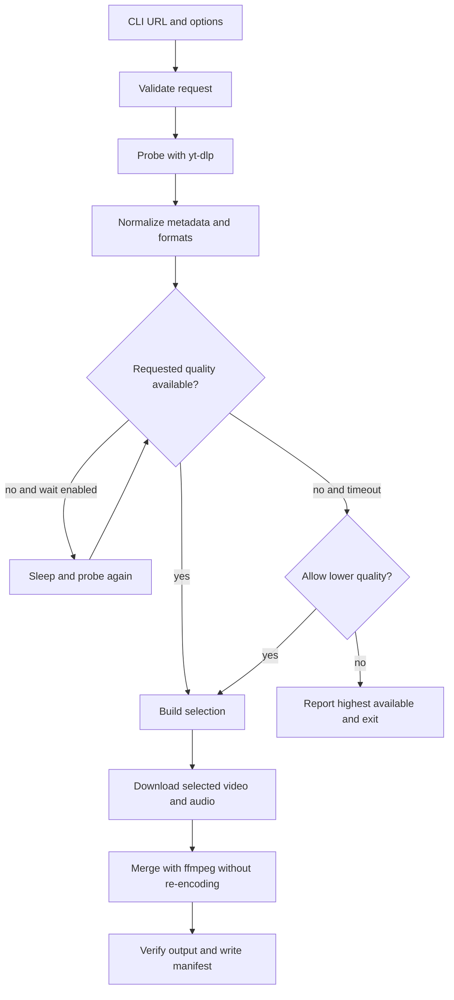

# YouTube Stream Downloader: Project Design and Implementation Plan

**Date:** 2026-10-25  
**Status:** Approved design; implementation has not started  
**Target:** Windows first, command line interface

## 1. Goal

Build a small command line application that downloads a YouTube video or ended live stream archive using the highest quality format YouTube makes available to the current session.

The main use case is an ended live stream that plays at 1080p on YouTube but is offered as only 480p by the YouTube Studio download button. The application should inspect the available formats, select separate high quality video and audio streams when present, and merge them without re-encoding.

The application must explain the quality that YouTube exposes. It cannot restore quality that is absent from the archive, unavailable to the session, or still being processed by YouTube.

## 2. Scope

### Version 1 includes

- A Windows-friendly CLI with `download`, `inspect`, and `doctor` commands.
- One YouTube URL per command invocation.
- Ended live stream archives and ordinary YouTube videos.
- Format inspection before download.
- A maximum quality profile that prefers the best video-only plus best audio-only streams.
- An MP4 compatibility profile for devices that cannot play the default container or codecs.
- A finite wait mode for an archive whose requested quality is not available yet.
- Resume support, fragment retries, and safe temporary files.
- Progress reporting with selected resolution, codec, speed, ETA, and final output path.
- Optional browser cookie loading for content the user is authorized to access.
- Dependency diagnostics for yt-dlp, ffmpeg/ffprobe, and the JavaScript runtime/EJS support required by current yt-dlp YouTube extraction.

### Version 1 does not include

- Recording an active livestream while it is happening.
- Automatic channel monitoring, playlists, scheduled jobs, or a download queue.
- A desktop GUI.
- DRM circumvention, CAPTCHA solving, proxy rotation, or custom token harvesting.
- Re-encoding media. The first version should preserve the downloaded codecs and quality through stream copying and muxing.
- An attempt to bypass private, paid, age, geographic, or account restrictions. The user may provide their own authorized browser session where yt-dlp supports it.

Active livestream capture can be added later as a separate mode. yt-dlp exposes `--live-from-start`, but its upstream documentation describes that behavior as experimental, so it should not be the foundation of the first release.

## 3. Research findings

### 3.1 yt-dlp is the correct download engine

yt-dlp already handles YouTube extraction, format selection, fragmented DASH/HLS downloads, retries, output templates, cookies from supported browsers, and post-processing hooks. Reimplementing YouTube manifest extraction would make the project fragile and duplicate upstream maintenance.

The application should use the yt-dlp Python API behind a narrow adapter. The adapter owns yt-dlp options and events; the rest of the application works with project-defined models and errors.

### 3.2 High quality often means two streams

YouTube commonly exposes a high resolution video-only stream and a separate audio-only stream. A download that selects only a combined format can therefore be limited to a lower resolution even when 1080p video is available.

The primary selection policy should follow yt-dlp's documented pattern:

```text
bv+ba/b
```

This means best video-only plus best audio-only, falling back to the best combined format when separate streams are unavailable. yt-dlp requires ffmpeg to merge separate streams.

The application must not silently force a 480p cap. It should show the highest available height during inspection and report the selected video and audio formats before the download begins.

### 3.3 An archive can be lower quality temporarily

YouTube automatically archives live streams that are less than 12 hours, according to YouTube's creator help documentation. The archive can be playable before all derived formats have finished processing. A user may therefore see a working 480p representation while higher resolutions are still being prepared.

There is no reliable general-purpose promise that an archive will later expose 1080p. The application should use a finite polling mode rather than waiting forever:

1. Probe the URL.
2. Identify whether the URL appears to be a post-live archive and whether the requested minimum height is available.
3. If the requested height is missing and wait mode is enabled, retry after a configurable interval.
4. Stop at a configurable deadline.
5. On timeout, either fail with a clear explanation or download the best available quality only when the user explicitly allows fallback.

The default should protect the user's stated quality goal: if they request 1080p and it is unavailable at the deadline, report the highest available quality and require an explicit lower-quality fallback.

### 3.4 Current yt-dlp YouTube setup has more than one dependency

Current yt-dlp guidance recommends:

- `ffmpeg` and `ffprobe` for merging and post-processing.
- `yt-dlp-ejs` for YouTube JavaScript challenge solving.
- A supported JavaScript runtime. The current EJS guide recommends Deno; Node is also supported with the appropriate runtime setting.

The project should expose these requirements through `stream-downloader doctor` instead of allowing a failed download to be the first setup signal. The planned Windows setup should prefer the official yt-dlp executable or a Python environment with the matching default dependency group, plus a discoverable ffmpeg and JavaScript runtime.

### 3.5 Authentication must be explicit

yt-dlp supports loading cookies from browsers such as Chrome, Edge, Firefox, Brave, Chromium, Opera, Safari, Vivaldi, and Whale. This can help when the user is already authorized to view content or when YouTube exposes different formats to an authenticated session.

The application should accept a browser and optional profile as an explicit option. It should not copy raw cookies into the project, print cookie values, or persist them in application logs.

## 4. User experience

### 4.1 Commands

```text
stream-downloader inspect <url> [options]
stream-downloader download <url> [options]
stream-downloader doctor [options]
```

#### `inspect`

Performs metadata and format extraction without downloading media. It should show:

- title, video ID, channel, upload or start date, duration, and live/archive state;
- whether the content is currently live, scheduled, ended, unavailable, or still incomplete according to yt-dlp;
- the highest available video height and frame rate;
- the selected video and audio format IDs for the active quality profile;
- container and codec information;
- whether ffmpeg, ffprobe, and JavaScript support are required or missing.

The command should support a machine-readable JSON output option for later automation.

#### `download`

Runs the same inspection and selection path, then downloads the chosen formats. The console should print a concise preflight summary such as:

```text
Title:       Example live archive
Available:   1080p60
Selected:    video 137 (1080p, avc1) + audio 140 (m4a, mp4a)
Output:      downloads/Example live archive [abc123].mkv
```

During the download, progress should include the current phase: probing, downloading video, downloading audio, merging, or complete.

#### `doctor`

Checks the local runtime and reports a fix for each missing dependency. It should check:

- Python version, if running from source;
- yt-dlp version and importability;
- ffmpeg executable and version;
- ffprobe executable and version;
- JavaScript runtime availability and configured runtime;
- yt-dlp EJS package or bundled EJS availability;
- write access to the configured output and temporary directories;
- optional browser names and profiles supplied by the user.

`doctor` must not print cookies or inspect browser history beyond what is needed to verify an explicitly requested browser profile.

### 4.2 Quality profiles

The CLI should expose named profiles instead of asking users to write yt-dlp selector expressions.

#### `maximum` (default)

- Select the best video-only stream plus the best audio-only stream, falling back to the best combined stream.
- Prefer the highest available resolution and frame rate using yt-dlp's normal quality sorting.
- Use MKV as the merge container when necessary so the application does not reject common VP9, AV1, or Opus combinations.
- Do not transcode.

#### `mp4`

- Prefer MP4 video and M4A audio when available.
- If an MP4-compatible selection would reduce the requested resolution, use the higher-quality selection and output MKV.
- If no MP4-compatible selection exists at the requested minimum height, use the maximum profile and output MKV rather than lowering quality.
- Never lower resolution silently just to satisfy an MP4 preference.

#### Requested minimum quality

The user may specify a minimum height, for example `--min-height 1080`. The selection layer should reject a result below that height unless `--allow-lower-quality` is provided.

This distinction matters because “best available” and “at least 1080p” are different requests.

### 4.3 Output naming and files

Default output directory:

```text
./downloads
```

Default filename pattern:

```text
%(upload_date)s - %(title)s [%(id)s].%(ext)s
```

The implementation should use yt-dlp's filename sanitization and output templates, not hand-built filesystem names. Temporary fragments and pre-merge files should live in a temporary path and be removed only after a successful merge.

The first version should write one optional sanitized manifest per completed download. The manifest may include URL, video ID, title, selected format IDs, resolution, codecs, container, yt-dlp version, and completion time. It must not include cookies or long-lived signed media URLs.

## 5. Architecture

Use Python 3.11+ with a `src/` layout and a small standard-library CLI. Keep the yt-dlp API behind an adapter so yt-dlp changes do not spread through the project.

```text
src/stream_downloader/
    __main__.py
    cli.py
    config.py
    errors.py
    models.py
    quality.py
    service.py
    yt_dlp_adapter.py
    output.py
    diagnostics.py
```

### Responsibilities

#### `cli.py`

- Parse commands and options.
- Convert exceptions into concise user-facing messages and stable exit codes.
- Select text or JSON output.
- Never contain yt-dlp selector details.

#### `config.py`

- Hold defaults for output, temporary paths, quality profile, retry counts, wait interval, and timeout.
- Load explicit config files only after command line arguments are parsed.
- Keep credentials and cookie paths out of normal serialized configuration.

#### `models.py`

Define stable project types such as:

- `VideoRequest`;
- `VideoMetadata`;
- `FormatCandidate`;
- `SelectionResult`;
- `DownloadProgress`;
- `DownloadResult`;
- `DiagnosticResult`.

These models should contain only data needed by the application and should not expose the entire yt-dlp info dictionary.

#### `quality.py`

- Map named profiles to yt-dlp selector options.
- Validate minimum height and fallback rules.
- Compare the extracted format table with the requested quality.
- Produce a human-readable selection explanation.

This module should be pure logic wherever possible, so it can be checked with fixture data without network access.

#### `yt_dlp_adapter.py`

- Construct yt-dlp options.
- Call `extract_info` for probing and `download` for the final operation.
- Register progress and postprocessor hooks.
- Normalize yt-dlp's info dictionaries and exception types into project models.
- Configure ffmpeg paths, browser cookies, retries, fragments, output templates, and temporary paths.

The adapter is the only module allowed to import yt-dlp.

#### `service.py`

Coordinate the application workflow:

1. Validate the URL.
2. Probe metadata and formats.
3. Apply the quality policy.
4. Optionally poll for a requested quality.
5. Confirm the final selection.
6. Download and merge.
7. Verify the result and return a `DownloadResult`.

The service should not format terminal output directly.

#### `output.py`

- Render text summaries and progress.
- Render stable JSON for scripts.
- Write the sanitized completion manifest.

#### `diagnostics.py`

- Detect executable versions and importability.
- Check filesystem access.
- Produce actionable setup messages.

## 6. Download data flow



The selection is made from the current format table on every probe. Format IDs must not be cached across runs because YouTube format URLs and availability can change.

## 7. Error handling and exit codes

Use stable exit categories so scripts can react without parsing human text:

```text
0  success
2  invalid command or URL
3  missing or invalid local dependency
4  authentication or authorization failure
5  requested quality unavailable
6  media unavailable, deleted, private, or blocked
7  network, rate limit, or retry exhaustion
8  download or merge failure
9  output or filesystem failure
10 unexpected application error
```

Messages should include the next useful action. Examples:

- Missing ffmpeg: install ffmpeg and ensure `ffmpeg.exe` is on PATH, or pass its path in configuration.
- Available only at 480p: show the maximum detected height and suggest `inspect`, waiting for archive processing, or `--allow-lower-quality`.
- Browser cookies rejected: close the browser, verify the profile, and retry without saving cookies to the project.
- Archive still processing: use `--wait-for-height 1080 --wait-timeout 30m` or retry later.
- Merge failed: preserve the downloaded parts and print the exact ffmpeg diagnostic location.

Do not hide a successful download behind a warning. If the final file is lower than the requested minimum, the command must either fail or say explicitly that the user allowed fallback.

## 8. Reliability details

- Use yt-dlp's partial file and resume behavior.
- Set bounded retries for normal requests and fragments.
- Keep fragment concurrency conservative by default; allow configuration later.
- Use a temporary directory separate from the final output directory.
- Treat post-processing as a distinct phase so a failed merge can be retried without downloading the media again when possible.
- Verify that the final path exists and that ffprobe can read its duration and video height.
- Do not claim that the output is 1080p based only on the selected format. Read the resulting file with ffprobe.
- Keep the original URL and video ID in the manifest for later auditing.
- Avoid retry storms and respect yt-dlp's rate-limit and sleep options.

## 9. Configuration and installation plan

### Development setup

```text
Python 3.11+
yt-dlp[default]
ffmpeg and ffprobe
Deno (preferred) or Node with yt-dlp's configured JavaScript runtime
```

Use `pyproject.toml` with a console script entry point. Keep runtime dependencies small:

- `yt-dlp[default]` for the extraction engine, EJS package, and supported defaults;
- no GUI framework in version 1;
- no web service or database.

The repository should include:

- `README.md` with installation and first download examples;
- `docs/USER_GUIDE.md` with quality profiles and troubleshooting;
- `docs/PROJECT_PLAN.md` linking to this design and tracking later phases;
- `.gitignore` excluding downloads, temporary files, local config, cookies, and manifests containing user metadata;
- a sample configuration file with no secrets.

### Windows distribution direction

Start with source installation for development. After the CLI is stable, evaluate a standalone Windows package. A packaged application must still account for ffmpeg and a JavaScript runtime unless they are bundled and their licenses and update path are handled correctly.

The first release should document the official yt-dlp Windows executable and current upstream dependency instructions rather than silently downloading executables from an unverified third party.

## 10. Implementation phases

### Phase 1: project foundation

- Create the Python package, `pyproject.toml`, console entry point, and documentation structure.
- Add configuration models and stable error types.
- Add `doctor` with dependency checks.
- Add `inspect` with text and JSON output.

**Exit condition:** a user can diagnose setup and see the maximum available formats without downloading media.

### Phase 2: quality selection

- Implement `maximum` and `mp4` profiles.
- Normalize format metadata.
- Add minimum-height validation and explicit lower-quality fallback.
- Print the exact selection explanation before downloading.

**Exit condition:** inspection clearly distinguishes available quality, selected quality, and requested minimum quality.

### Phase 3: downloading and merge

- Implement the yt-dlp download adapter.
- Add progress hooks and postprocessor events.
- Configure temporary files, resume, retries, and output templates.
- Verify the final file with ffprobe.
- Write the sanitized completion manifest.

**Exit condition:** an ended live archive with an available 1080p format produces a merged file whose video height is verified as 1080p or higher without re-encoding.

### Phase 4: post-live processing wait

- Detect a missing requested height during a probe.
- Add bounded polling with interval and timeout.
- Display each probe result and the highest available height.
- Require an explicit flag for a lower-quality result after timeout.

**Exit condition:** the command does not silently settle for 480p while a requested 1080p wait is active.

### Phase 5: hardening and packaging

- Improve messages for common YouTube and dependency failures.
- Add fixture-based checks for format selection and error mapping.
- Add installation documentation for Windows.
- Evaluate standalone packaging after the dependency behavior is stable.

### Later phase: active livestream mode

Add active stream support only after archive downloading is reliable. This phase needs separate decisions for live-from-start, current-time capture, interruption recovery, partial output, and whether the user wants the later YouTube archive or a locally captured recording.

## 11. Verification strategy

The implementation plan should use offline fixtures for most logic and a small manually selected set of authorized YouTube test videos for integration verification.

Required verification scenarios:

1. A normal video with separate high resolution video and audio formats.
2. An ended live archive with 1080p available.
3. An archive whose highest currently available format is 480p.
4. A requested 1080p download that times out and fails without explicit fallback.
5. The same timeout with explicit lower-quality fallback.
6. A video with only a combined format.
7. An MP4-compatible and a WebM/AV1-oriented format table.
8. Missing ffmpeg or ffprobe.
9. Missing JavaScript runtime/EJS support.
10. Authorized browser-cookie access and a cookie-free public URL.
11. Interrupted downloads that resume.
12. A merge failure where intermediate files remain available for diagnosis.

The application should record selected format IDs and final ffprobe facts so a user can distinguish a YouTube availability limitation from a selection bug.

## 12. Risks and decisions

### Upstream breakage

YouTube changes its extraction behavior. The project should keep yt-dlp current, expose its version in `doctor`, and avoid hard-coding YouTube format IDs or client behavior.

### Format availability differs by session

Cookies, age status, geography, device, and YouTube processing state can change the format table. The application should show the current session's results and avoid promising a fixed resolution.

### Container compatibility

Maximum quality may produce MKV with VP9, AV1, or Opus. MP4 compatibility can require a different source selection and must not be allowed to silently lower quality. Re-encoding is outside the first version.

### Archive processing is not observable as a simple countdown

The wait feature is necessarily heuristic. It must be bounded, transparent, and optional. If YouTube never exposes 1080p, the tool should stop and say so.

### Credentials and privacy

Browser cookies can grant account access. They must remain under the user's browser and should be passed to yt-dlp only for the requested invocation. Logs, manifests, and error reports must exclude cookie values and signed media URLs.

## 13. Source references

Primary sources consulted on 2026-10-25:

- [yt-dlp README](https://github.com/yt-dlp/yt-dlp/blob/master/README.md): installation, dependencies, format selection, merging, retries, cookies, livestream options, and Python API.
- [yt-dlp latest releases](https://github.com/yt-dlp/yt-dlp/releases/latest): current release channel and version awareness.
- [yt-dlp EJS guide](https://github.com/yt-dlp/yt-dlp/wiki/EJS): JavaScript runtime and `yt-dlp-ejs` setup for current YouTube support.
- [YouTube Help: Archive live streams](https://support.google.com/youtube/answer/6247592): automatic archive behavior and the 12-hour archive limitation.
- [YouTube Terms of Service](https://www.youtube.com/static?template=terms): use the tool only for content the user is authorized to download and in accordance with applicable terms and law.

